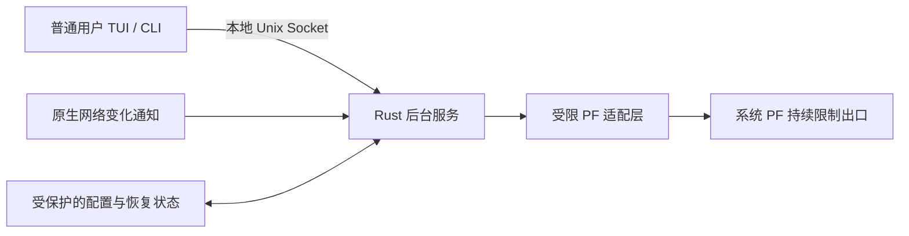

# TunLatch 技术栈调研与选型建议

调研日期：2026-11-02（America/Los_Angeles）。

> 状态：这是 2026-11-02 的选型调研快照，不是当前实现状态。工作区已经建立并固定依赖；当前版本、能力和验证结果以 `Cargo.lock`、[README](../README.md) 与代码为准。下文保留当时的版本与结论，未逐条回填后续进展。

当时结论：第一轮选型调研完成，关键系统能力待原型验证。本文是技术建议，不替代 [需求文档](REQUIREMENTS.md)，不代表已完成实现或实机防泄漏验证。编码约定见 [Rust 代码规范与实践指导](CODING-GUIDELINES.md)。

## 1. 推荐方向

推荐采用 **Rust 2024 + Ratatui/Crossterm + Tokio + macOS 原生网络通知 + 独立 PF 后台服务**。

本项目中，更先进的技术路线应落实为类型明确的系统接口、事件驱动的状态更新、可验证的规则切换和权限分离。依赖采用稳定版本，具体版本通过 `Cargo.lock` 固定；当前固定结果以 `Cargo.lock` 为准，不为追求新版本而依赖未发布接口，也不预先引入完整应用框架、插件系统或复杂规则语言。

### 推荐组件

下表版本来自调研时查询的 crates.io 发布元数据与对应项目文档，是候选版本快照。当前工作区已固定并联合构建所选依赖，实际版本以 `Cargo.lock` 为准。

| 层次 | 候选组件 / 版本 | 用途与选择理由 |
| --- | --- | --- |
| 语言与构建 | Rust stable、Edition 2024、Cargo | 全部自研程序逻辑使用 Rust；工作区固定 Rust/Cargo 1.99.1 |
| 终端界面 | [Ratatui 0.30.2](https://docs.rs/ratatui/0.30.2/ratatui/) + [Crossterm 0.29.0](https://docs.rs/crossterm/0.29.0/crossterm/) | 界面绘制、布局、键盘、鼠标和终端事件 |
| 规则文本编辑 | [ratatui-textarea 0.9.4](https://crates.io/crates/ratatui-textarea/0.9.4) | 复用多行输入、撤销重做、选择和搜索能力，按需启用功能 |
| 异步运行与取消 | [Tokio 1.54.1](https://docs.rs/tokio/1.54.1/tokio/) + [tokio-util 0.7.20](https://crates.io/crates/tokio-util/0.7.20) | IPC、通知汇聚、超时、任务取消和受控关闭 |
| PF 管理 | [pfctl 0.7.0](https://docs.rs/pfctl/0.7.0/pfctl/) 优先，受限系统工具作为必要补充 | 直接通过 `/dev/pf` 与 ioctl 管理类型化规则、事务及连接状态；能力缺口见第 2 节 |
| 网卡快照 | [nix 0.31.3](https://docs.rs/nix/0.31.3/nix/ifaddrs/fn.getifaddrs.html) + 必要的 `libc` | 调用 `getifaddrs` 等接口，按网卡归并 IPv4/IPv6 信息，避免解析 `ifconfig` 文本 |
| 网络变化通知 | [objc2-system-configuration 0.3.2](https://docs.rs/objc2-system-configuration/0.3.2/objc2_system_configuration/) + [objc2-core-foundation 0.3.2](https://docs.rs/objc2-core-foundation/0.3.2/objc2_core_foundation/) | 使用 SystemConfiguration 动态存储及其通知接口；必要时以路由套接字补充 |
| 原生回调调度 | [dispatch2 0.3.1](https://crates.io/crates/dispatch2/0.3.1) | 为原生通知提供 GCD 队列；与专用 CFRunLoop 方案二选一，按实际 API 适配决定 |
| 命令行入口 | [clap 4.6.7](https://crates.io/crates/clap/4.6.7) | TUI 入口及可离线使用的状态、恢复、安装卸载命令 |
| 数据模型与文件 | [Serde 1.0.229](https://crates.io/crates/serde/1.0.229)、[TOML 1.1.8+spec-1.1.0](https://docs.rs/toml/latest/toml/)、[serde_json 1.0.154](https://crates.io/crates/serde_json/1.0.154) | TOML 用于可读配置和导入导出，JSON 用于本地 IPC 消息 |
| 地址与网段 | [ipnet 2.12.2](https://crates.io/crates/ipnet/2.12.2) + `std::net` | 明确区分 IP、网段和端点；在 PF 适配边界与其 `ipnetwork` 类型转换 |
| 错误与诊断 | [thiserror 2.0.21](https://crates.io/crates/thiserror/2.0.21)、[anyhow 1.0.104](https://crates.io/crates/anyhow/1.0.104)、[tracing 0.1.44](https://crates.io/crates/tracing/0.1.44)、[tracing-subscriber 0.3.23](https://crates.io/crates/tracing-subscriber/0.3.23) | 领域错误可区分，程序入口补充上下文，后台记录结构化事件 |
| 后台与安装配置 | macOS LaunchDaemon + [plist 1.10.3](https://crates.io/crates/plist/1.10.3) | Rust 程序负责安装卸载与配置生成，由系统 `launchd` 管理服务 |

调研时本机环境为 macOS 26.6.2、arm64、SDK 27.2。SDK 版本不等于最低运行系统版本。Ratatui 0.30.2 的声明 MSRV 为 Rust 1.88；最终项目 MSRV、最低 macOS 版本和 Intel 支持范围需在依赖解析及系统验证后确定。

## 2. PF：优先采用类型化库，但必须补齐能力核查

### 为什么重点评估 Mullvad 的 pfctl-rs

[pfctl-rs](https://github.com/mullvad/pfctl-rs) 是面向 macOS PF 的 Rust 库，直接调用 ioctl，具有规则构建、anchor 和事务接口。Mullvad 当前的 [talpid-core 依赖配置](https://github.com/mullvad/mullvadvpn-app/blob/main/talpid-core/Cargo.toml) 使用 `pfctl = "0.7.0"`，其 [macOS 防火墙实现](https://github.com/mullvad/mullvadvpn-app/blob/main/talpid-core/src/firewall/macos.rs) 也提供了规则更新和已有连接处理的实际参考。

已确认的库能力包括：

- 通过 `AnchorChange` / `Transaction` 批量提交规则变更，避免把逐条修改规则当作一次完整更新。
- 查询 PF 是否启用，枚举连接状态，移除指定状态，按 anchor 或接口清理状态。
- 构建具有明确方向、接口、协议、地址及端口的过滤规则。

这些能力见 [PfCtl API](https://docs.rs/pfctl/0.7.0/pfctl/struct.PfCtl.html) 和 [事务接口说明](https://docs.rs/pfctl/0.7.0/pfctl/)。规则事务不包含磁盘配置写入，也不会自动使全部旧连接状态失效，仍需单独设计恢复顺序与状态处理。

### 已发布版本的缺口

本次检查了 **crates.io 实际发布的 0.7.0 源码**，没有仅凭仓库 `main` 的接口推断发布版能力。

| 事项 | 调研结果 | 后续处理 |
| --- | --- | --- |
| 接口绑定的连接状态 | `StatePolicy` 只暴露 None / Keep / Modulate / SynProxy，没有直接提供 `if-bound` 选项 | 需要验证少量扩展绑定或系统规则加载途径；不能把 `Keep` 当作接口绑定 |
| PF 启用引用计数 | 高层 API 提供全局启用、停用，未提供与系统 `pfctl -E` / `-X token` 对应的高层方法 | 管理本项目自身的引用及恢复，不能在退出时直接全局停用 PF |
| 规则计数和实际执行位置 | 存在状态查询接口，但不足以覆盖所有运行时规则检查与统计需求 | 核查必要 ioctl 或限定范围的系统查询，界面不能只显示配置中的期望值 |
| 仓库与发布版差异 | `main` 的接口描述查询等能力包含未发布变更 | 优先稳定发布版，必要补丁固定版本并记录，不直接跟随分支漂移 |

参考：[StatePolicy](https://docs.rs/pfctl/0.7.0/pfctl/enum.StatePolicy.html)、[发布版源码](https://docs.rs/crate/pfctl/0.7.0/source/src/lib.rs)、[更新记录](https://github.com/mullvad/pfctl-rs/blob/main/CHANGELOG.md)。本机 `man pf.conf` 说明默认状态策略为 `floating`，允许跨接口匹配；`man pfctl` 则明确区分全局启停和引用计数启停。

建议把 PF 操作集中在一个范围明确的适配层内，优先使用库。若关键能力需要补充，可使用少量、经过核对的 Rust FFI，或以固定绝对路径和结构化参数调用系统 `pfctl`。这仍符合全部自研代码使用 Rust 的要求。不能为避免任何子进程而自行重写完整 PF 绑定。

独立 anchor 也不等于保护自动有效：必须核查它在活动规则集中的实际执行顺序、其他 `quick` 规则和接口 skip 设置。仅清理本项目 anchor 的状态，不能证明启用保护之前由其他规则建立的直连状态已经失效。

## 3. 网卡与路由：事件通知负责更新，PF 持续限制出口

推荐使用 **原生快照 + 原生事件通知 + 必要时补充路由套接字**：

1. 启动时通过 `getifaddrs` 建立快照，保留 IPv4、IPv6、接口编号、名称和标志，按接口归并，不能把没有 IPv4 地址的 TUN 排除。
2. 使用 `SCDynamicStore` 订阅网络配置变化，在变化后重新建立一致快照。其 [Rust 绑定](https://docs.rs/objc2-system-configuration/0.3.2/objc2_system_configuration/struct.SCDynamicStore.html) 提供通知键、CFRunLoop 和 GCD 调度途径，对应 [Apple 原生接口](https://developer.apple.com/documentation/systemconfiguration/scdynamicstore-gb2)。
3. 对第三方直接创建的 utun、手工路由变化及遗漏场景，评估 Darwin `PF_ROUTE` 套接字。当前系统 `man 4 route` 记录了路由消息机制；是否覆盖所需的所有变化仍需实测。非阻塞文件描述符可考虑接入 Tokio `AsyncFd`。
4. 原生回调通过受控通道通知后台，不把线程约束和裸指针扩散到业务层。允许低频完整性核对和唤醒后重新扫描，持续出口保护不依赖这些检查的响应速度。

`objc2-*` 是 Rust 绑定，调用系统框架不需要编写 Swift 或 Objective-C 业务代码。原生对象的线程及生命周期约束仍然存在，须在小范围内封装并核对。

### 不能通过库选择直接解决的事情

网络事件说明接口或配置发生了变化，不能证明新接口属于 v2rayN，也不能证明所有流量已经经过代理。

可信绑定需要结合实际运行的代理核心、受控的运行配置或本地接口等证据；单独使用接口名、接口编号、点对点标志或 IP 网段不足以完成确认。v2rayN 当前上游 [CoreManager](https://github.com/2dust/v2rayN/blob/master/v2rayN/ServiceLib/Manager/CoreManager.cs) 存在多种核心启动路径，不能预设所有安装都由同一种核心创建 TUN。具体适配应以用户安装版本为准。

候选接口出现但身份尚未确认时保持阻断。自动重绑定、旧编号复用和事件丢失的处理列为核心验证项，而非仅靠增加网络监控库来解决。

## 4. TUI：比较现代选项，主选 Ratatui

| 方案 | 特点 | 本项目判断 |
| --- | --- | --- |
| Ratatui 0.30.2 + Crossterm 0.29.0 | 控件、布局、终端后端和测试能力可组合；Crossterm 提供可接入 Tokio 的异步事件流 | 主选，适合规则表格、状态视图、配置编辑和清晰的输入控制 |
| iocraft 0.9.3 | 声明式组件、hooks 和 Flexbox 布局，开发方式接近 React / SwiftUI | 保留为备选；更看重声明式界面开发时可做小规模对比，不因此改变防火墙后端 |
| Cursive 0.21.1 | 回调式视图和终端界面工具箱 | 可以实现需求，本轮未发现足以优先于前两者的项目收益 |

参考：[Ratatui 后端文档](https://ratatui.rs/concepts/backends/)、[Crossterm EventStream](https://docs.rs/crossterm/0.29.0/crossterm/event/struct.EventStream.html)、[iocraft 官方说明](https://github.com/ccbrown/iocraft)、[Cursive](https://crates.io/crates/cursive/0.21.1)。以上优先级是结合本项目需求的判断，不是通用性能排名。

规则编辑优先评估 Ratatui 项目维护的 [ratatui-textarea](https://github.com/ratatui/ratatui-textarea)。已核对发布依赖：Ratatui 0.30.2 与 ratatui-textarea 0.9.4 使用兼容的 `ratatui-core 0.1`、`ratatui-widgets 0.3` 版本范围。不能把旧版 `tui-textarea` 的兼容性直接套用于新版 Ratatui；仍需在实际依赖解析时检查重复版本与终端后端一致性。[发布依赖记录](https://crates.io/api/v1/crates/ratatui-textarea/0.9.4/dependencies)

## 5. 运行组织、权限与本地通信

推荐将普通用户 TUI 与需要管理员权限的后台服务分开。后台通过 macOS LaunchDaemon 管理，退出 TUI 不解除 PF 规则。该组织方式与 [Apple 对 LaunchDaemon 的说明](https://developer.apple.com/library/archive/documentation/MacOSX/Conceptual/BPSystemStartup/Chapters/DesigningDaemons.html) 一致；当前系统后台授权行为还应结合 [Service Management 文档](https://developer.apple.com/documentation/servicemanagement/updating-helper-executables-from-earlier-versions-of-macos) 和本机手册验证。

建议的职责关系如下，不预设完整模块或 crate 拆分：

- IPC 主选 Tokio Unix Domain Socket，使用 Serde 消息和有限长度的消息帧，保留协议版本及明确的错误响应。无需为单机本地控制引入 HTTP、gRPC 或远程监听端口。
- [Tokio UnixStream](https://docs.rs/tokio/1.54.1/tokio/net/struct.UnixStream.html) 支持获取对端凭据。套接字目录和权限、UID 校验、可调用操作集合均需限制；UID 只能标识用户，不能证明用户亲自确认了敏感操作。
- 停用保护、修改直连例外、安装卸载等敏感操作需明确管理员授权策略，不能默认向普通用户可写的套接字开放任意规则、文件或命令执行能力。
- PF 更新串行处理，区分期望策略、已提交策略和实际观测状态，防止过期任务覆盖较新的阻断决定。使用明确的 Rust 类型和状态转换即可，不先引入通用状态机或 actor 框架。
- LaunchDaemon 负责启动和进程恢复；已经生效的阻断规则负责后台异常期间的保护。`KeepAlive` 不能证明开机时网络尚未放行，更不能替代 PF 本身。

Rust 安装程序可生成 plist，并通过固定参数调用系统 `launchctl` 等工具，不需要自研服务管理器或以 shell 脚本承载核心逻辑。是否采用 socket activation 留待需要时决定；启动保护不能等到用户打开 TUI 才建立。

## 6. 配置与持久化：当前建议先用文件

主选 **Serde + TOML + 受保护的原子文件更新**。当前规则、必要例外和启停意图主要属于小规模结构化配置，文件更便于导入导出与离线恢复。写入需要校验、同目录临时文件替换、持久化与权限控制，不能把普通文本覆盖写入视为完整的崩溃恢复方案。[TOML 与 Serde 的集成](https://docs.rs/toml/latest/toml/)

如后续明确需要数据库，再按数据访问需求选择：

| 方案 | 已核对的版本 | 适用条件 |
| --- | --- | --- |
| redb | 4.4.0，声明 MSRV 1.90 | 需要纯 Rust 的嵌入式事务键值存储、版本状态或恢复记录 |
| rusqlite + SQLite | 0.41.1，声明 MSRV 1.89 | 需要 SQL 查询、关系数据、审计记录与通用数据库工具支持 |
| SQLx | 0.9.0，声明 MSRV 1.94 | 明确需要较复杂的异步 SQL 数据访问时再评估，本项目当前收益不足 |

[redb](https://docs.rs/redb/4.4.0/redb/) 提供 ACID 键值存储；[rusqlite](https://docs.rs/rusqlite/0.41.1/rusqlite/) 包装 SQLite。rusqlite 使用 SQLite 的 C 实现，不意味着本项目要编写 C 程序；但若将来进一步要求所有非系统依赖也必须纯 Rust，redb 更符合该额外约束。当前需求只要求全部自研代码使用 Rust。[SQLx 发布元数据](https://crates.io/api/v1/crates/sqlx/0.9.0)

数据库事务也不能与 PF 内核规则提交组成一个跨系统原子事务。无论选哪种存储，都要明确崩溃后的策略核对和保持阻断的恢复流程。

## 7. 与 VPN Kill Switch 的参考关系

参考版本：`vpn-kill-switch/killswitch` 0.8.3，提交 `58eb083f5daddc87fec1729056cebb04115fa115`。此前已阅读源码并做模拟网卡的规则生成验证；调研期间没有启用该工具或修改本机 PF。

| 方面 | 参考项目的做法 | 本项目建议 |
| --- | --- | --- |
| 网卡枚举 | 解析 `ifconfig`，仅将带 IPv4 的点对点接口纳入 VPN 列表 | 原生双栈快照，候选发现与可信身份确认分开 |
| 信任范围 | 放行全部识别到的点对点网卡 | 只绑定确认过的代理 TUN |
| 生命周期 | 一次生成和加载规则，没有持续重绑定服务 | 后台接收变化事件、核对状态并在确认后重绑定 |
| PF 更新 | 清空全局规则后加载生成的规则 | 优先管理自有 anchor，事务切换并核对实际执行位置 |
| 方向与例外 | 默认阻断包含入站，部分广播和组播直接放行 | 仅增加出站限制，必要直连例外显式收窄 |
| 控制界面 | 命令行参数 | TUI 与离线恢复命令共用受限控制接口 |

依据：[网卡枚举源码](https://github.com/vpn-kill-switch/killswitch/blob/58eb083f5daddc87fec1729056cebb04115fa115/src/killswitch/network.rs#L400-L472)、[规则生成源码](https://github.com/vpn-kill-switch/killswitch/blob/58eb083f5daddc87fec1729056cebb04115fa115/src/killswitch/rules.rs)、[PF 加载源码](https://github.com/vpn-kill-switch/killswitch/blob/58eb083f5daddc87fec1729056cebb04115fa115/src/killswitch/pf.rs)。参考其思路与已发现问题，不复制为项目骨架。

## 8. 验证工具与能力验证顺序

调研时列出的 Rust 检查候选为 `cargo fmt`、Clippy、[cargo-nextest 0.9.150](https://nexte.st/)、[proptest 1.12.0](https://proptest-rs.github.io/proptest/)、[insta 1.49.0](https://insta.rs/) 和 [cargo-deny 0.20.2](https://embarkstudios.github.io/cargo-deny/)。测试运行器属于开发工具，不应直接决定生产程序的 MSRV。

- 属性测试重点验证普通放行规则不能扩大直连范围、非法配置不替换有效配置、未知 TUN 不能获得信任等性质。
- 快照适合 TUI 关键视图、配置格式与诊断输出，不作为内核过滤有效的证据。
- 网络事件解析、状态转换和 IPC 可以脱离 root 做自动化验证；真实 PF、开机、网络切换与物理网卡泄漏需要隔离环境和实机验证。
- 依赖检查覆盖安全公告、许可证和来源策略。调研时尚未创建 Cargo 项目，也未执行本项目依赖扫描或联合构建；当前依赖与 `cargo-deny` 状态以 `Cargo.lock`、CI 配置和运行结果为准。

实现过程中仍需按以下顺序收敛关键能力：

| 验证项 | 需要回答的问题 | 不满足时的处理 |
| --- | --- | --- |
| PF 后端与共存 | 当前 macOS 上 anchor 是否实际生效？事务失败后是否保持旧规则？启用引用如何恢复和释放？ | 缩小并补齐适配层，必要时采用系统规则加载途径，不能借全局清空绕过问题 |
| 已有连接与状态 | 接口绑定或受控状态清理能否阻止 TCP/UDP/QUIC 已建连接回退直连？ | 保持阻断，修正状态策略后再扩大测试 |
| 原生通知覆盖 | 多 TUN、IPv6-only、路由变化、睡眠唤醒能否形成一致快照？ | 补充路由通知和重新扫描，不把轮询反应时间当作保护机制 |
| 可信重绑定 | 能否确认新 TUN 属于实际运行的同一代理？旧编号复用是否会错误继承信任？ | 保持阻断并要求手动确认 |
| 开机与异常恢复 | 首次出站到 PF 保护生效之间是否存在窗口？后台被结束后规则是否保留？ | 明确实际覆盖边界，不能以启动项存在就宣称零窗口 |
| 依赖联合验证 | TUI、编辑组件、异步与原生绑定能否在目标系统共同构建运行？ | 固定兼容的稳定版本与必要 feature，核对依赖树 |

上述验证顺序是调研时提出的后续工作建议；当时没有进行 PF 写入、安装后台服务或创建功能实现。当前进度见 [README](../README.md)。

## 9. 平台边界

Apple 将 PF 定位为系统实现细节及高级用户、管理员功能，不将其视为供大众分发产品使用的稳定 API。这与当前个人自用范围相容，但意味着 Rust 库、事件通知和现代 TUI 都不能消除 macOS 版本适配、系统规则冲突或启动时序问题。后续扩大支持范围时需重新验证。[Apple TN3165](https://developer.apple.com/documentation/technotes/tn3165-packet-filter-is-not-api)

因此，本次调研推荐可以确定到组件与技术路线；实际出口保护、可信 TUN 重绑定和重启覆盖仍是需要证据的系统能力，不能由“采用了先进技术栈”推导为已经实现。
